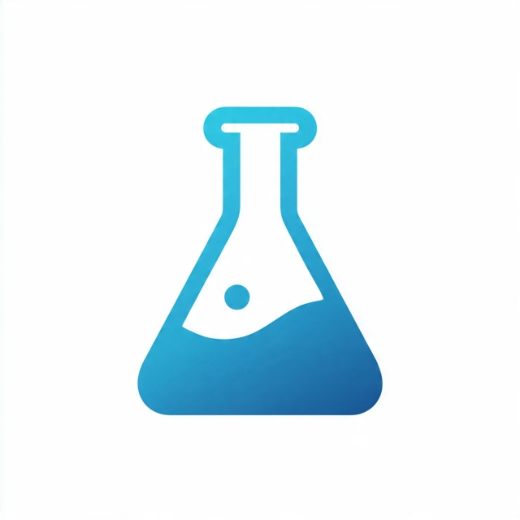

# CP Software

<p align="left">
  
</p>

This repository contains the software for the CerePhyte / CP measurement platform. It includes the dashboard and telemetry tooling used to monitor live data from the associated hardware system.

## Related repositories

- Hardware repository: https://github.com/ISLERI-labs/CP_hardware_resources
- Frimware repository: https://github.com/ISLERI-labs/CP_firmware

## Overview

The current codebase includes a dashboard application for displaying live telemetry, plotting A0 data, recording CSV history, and interacting with a local FastAPI backend. The main software entry point is located in the `CerePhyte_Dashboard/` folder.

## Repository structure

```text
CP_software/
├── CerePhyte_Dashboard/
│   ├── app.py
│   ├── main.py
│   ├── requirements.txt
│   ├── run.bat
│   ├── README.md
│   └── cerephyte_history.csv
├── images/
├── .gitignore
└── README.md
```

## Quick start

From the `CerePhyte_Dashboard/` directory:

### Windows

```powershell
py -m venv .venv
.\.venv\Scripts\python.exe -m pip install --upgrade pip
.\.venv\Scripts\python.exe -m pip install -r requirements.txt
run.bat
```

Then open:

```text
http://localhost:8501
```

### Notes

- `run.bat` starts the FastAPI backend and the Streamlit dashboard together.
- The dashboard reads telemetry from `http://127.0.0.1:8000/telemetry` by default.
- Logged CSV data is saved locally in `cerephyte_history.csv`.

## Documentation

See the [software documentation](docs/README.md) for setup instructions, the system architecture, API endpoints, dashboard controls, and CSV recording details.

## Hardware and software integration

This software repository is intended to work alongside the hardware resources repository, which provides the physical device design, instrumentation, and associated documentation. Together, they form the complete CP platform for data acquisition and monitoring.

## License

Copyright and License

Copyright © 2026 Omm Prakash Das.

This repository's original software is licensed under the Apache License, Version 2.0. See "LICENSE" (LICENSE) for the full license text.

Third-party components remain subject to their respective licenses.